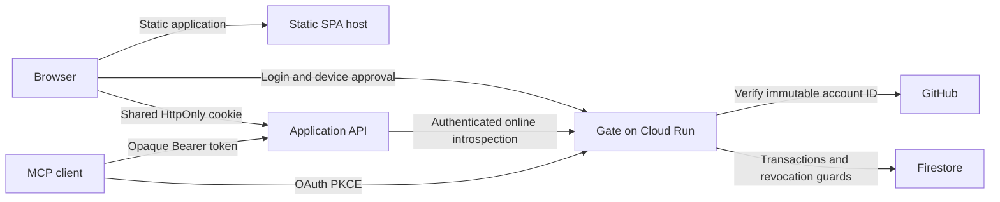

# Architecture

Gate is a personal identity and authorization service for a suite of applications. Node.js 24 and TypeScript host `oidc-provider`; the official Firestore SDK stores provider artifacts, identity state, browser approvals, browser sessions and device connections. GitHub supplies a stable numeric account identity for one configured user.

Gate serves its own login, approval and connection-management HTML. Application SPAs are hosted separately and call their resource APIs directly. Gate is the identity and online authorization service, without a BFF or application request proxy. Cloudflare supplies authoritative DNS and application static hosting; the Gate service uses a DNS-only record and a standard Cloud Run domain mapping for its configured origin. The Cloud Run resource name does not determine the public hostname.

## Responsibilities

`src/config.ts` validates the HTTPS issuer, cookie parent, exact browser return URIs, resource credentials and explicit Firestore project/database identifiers. `src/service.ts` composes OIDC, GitHub identity, device approval, browser session endpoints and connection management. `src/storage.ts` implements provider persistence and transactional session creation, logout and revocation. `packages/sdk` performs fresh resource-authenticated verification for opaque OAuth tokens and shared browser sessions.

OAuth protocol validation, authorization codes, PKCE, token exchange, refresh and opaque Bearer introspection remain owned by `oidc-provider`. Public MCP clients register through the provider DCR endpoint. `src/registration.ts` projects bounded untrusted metadata to a public authorization-code profile before provider validation; unsupported remote key/sector/request metadata is rejected without fetching it. HTTPS web callbacks and HTTP loopback native callbacks are validated, and S256 PKCE is mandatory. Registration creates no approval or application user. Resource clients authenticate through private introspection credentials and may introspect tokens only for their configured audience.

Browser applications register an `app_id` and exact HTTPS return URI. Gate validates that registration before redirecting, binds login state to the host-only login cookie, verifies the configured GitHub user and presents a separate approval page. Login identity alone is not API authorization. Approval creates a random common browser session and a separate `kind: browser` connection in one Firestore transaction. The session cookie is Secure, HttpOnly, SameSite=Lax and scoped to the validated operator-configured parent. Its stored session key is the SHA-256 hash of the cookie value.

Gate derives browser CORS origins from registered browser return URIs. Session bootstrap and logout accept only registered origins. Logout also validates CSRF, revokes the current device connection and deletes that browser session atomically. Management can revoke any browser or OAuth connection. Revocation never affects other devices or independent MCP grants.

Registration accepts at most 8192 bytes, ten redirect URIs of at most 2048 characters each and a client name of at most 100 characters. Names are self-asserted and shown as unverified beside the actual redirect at approval. Inert unsupported metadata is omitted from persistence and display. Registration management and client-metadata-document discovery are disabled. Firestore transactions limit registrations to 1000 over the namespace lifetime and 20 per fixed minute across instances. These limits bound registration storage, not all request costs; exhaustion can deny new registrations and requires operator intervention. Existing approved connections remain independently usable.

See [identity and registration controls](docs/security.md) for the exact GitHub account check, public-client registration limits and operator-only resource/browser registrations. Gate does not maintain an MCP tool registry.

## Persistence and authorization

| Firestore collection | Contents and retention |
| --- | --- |
| `gate_artifacts/<hashed model>/entries` | Hashed identifiers and payloads; durable DCR Client records and expiring protocol artifacts |
| `gate_dcr_state` | Transactional lifetime registration quota and fixed-minute rate counters shared across instances; no TTL |
| `gate_identity_sessions` | Host-only identity login sessions; 24-hour expiry |
| `gate_browser_login_attempts` | Browser-bound single-use login state; 10-minute expiry |
| `gate_browser_approvals` | Bound approval transactions; 10-minute expiry and consumed marker |
| `gate_browser_sessions` | Approved device sessions keyed by hashed session secret; fixed configured expiry |
| `gate_connections` | Browser/OAuth connection records and durable revocation guards; no TTL |

Queries by UID/user code use a single-field equality filter within a model collection. Listing connections filters on user ID, then sorts and excludes revoked records in application code. No composite query indexes are required. TTL policies cover `expiresAt` for expiring records, including the `entries` collection group. DCR Client records have no `expiresAt` and are not expired by that policy. Read-time expiry checks determine authorization independently of asynchronous cleanup.

Authorization-code and refresh-token consumption transactionally checks expiry, grant revocation and the existing consumed marker before setting it. A second consumption cannot succeed. Artifact upserts preserve consumed markers. OIDC login state is single-use. Browser approval state is bound to both login cookie and verified identity, expires independently and is consumed with session and connection creation in one transaction.

Each OAuth grant-related artifact read, consumption and upsert checks its connection guard in the same Firestore transaction. Revocation retains a durable tombstone and does not bulk-delete token documents. Delayed token writes cannot revive access. Browser session reads transactionally require a current session, unexpired timestamp and existing approved, nonrevoked browser connection. There is no optional missing-connection guard for browser sessions.

The SDK verifies OAuth and browser credentials online for every resource request, without caching positive results. Browser verification posts the session secret and configured resource audience to a fixed same-issuer endpoint with resource Basic authentication. It checks issuer, subject, connection, caller identity, audience, approval and expiry. APIs must reject ambiguous cookie/Bearer credentials, validate user ownership through their own enabled issuer/subject mapping, and enforce registered Origin plus CSRF for browser writes. A revocation cannot retract a resource operation whose authorization check already completed; subsequent checks reject the revoked connection.

Signing keys, cookie keys and resource credentials are externally configured. Actual issuer, parent cookie domain, redirect lists and runtime endpoints stay in ignored local configuration and are injected into the existing service template by the renderer. Cloud Run uses its dedicated service account and Application Default Credentials without database passwords or downloaded service-account keys. `/healthz` reports process liveness; `/readyz` checks Firestore with a two-second deadline. There are no organizations, roles, feature-level permissions, public signup or general administration framework.

Every host beneath the shared cookie parent belongs to the same trust boundary. Resource services receive the cookie and must protect it from disclosure. HttpOnly prevents script reads, while each application still owns XSS prevention, Origin/CSRF enforcement and its own explicit user data scope.

See [HTTP contracts](docs/api.md), [consumer integration](docs/integration.md), [configuration](docs/configuration.md) and [deployment](docs/deployment.md) for the operational interfaces.
